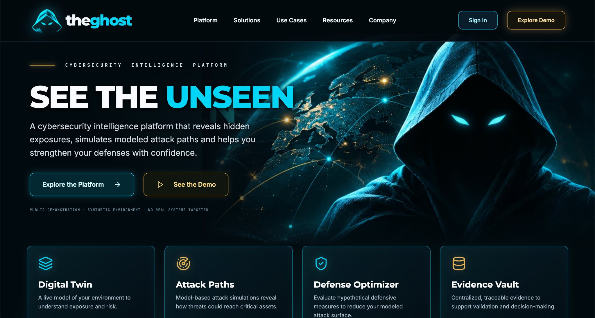
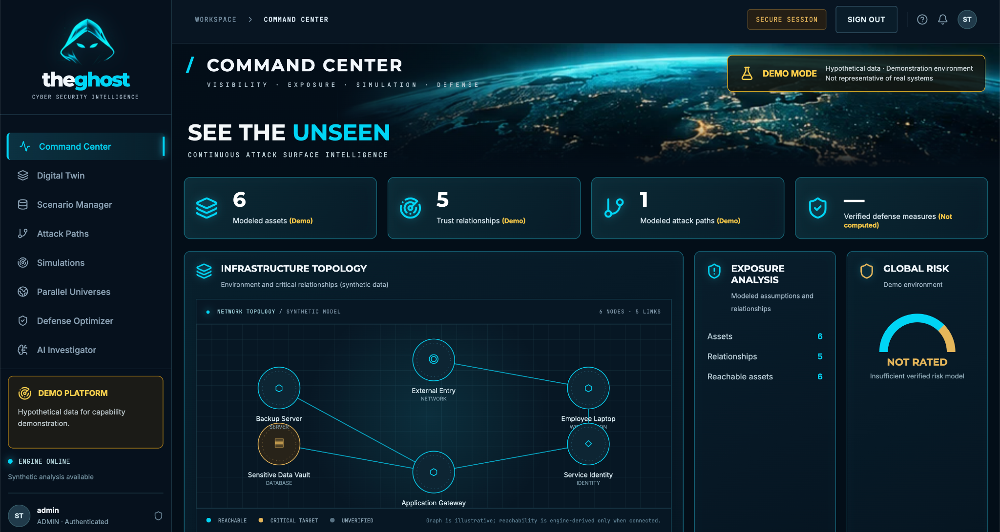
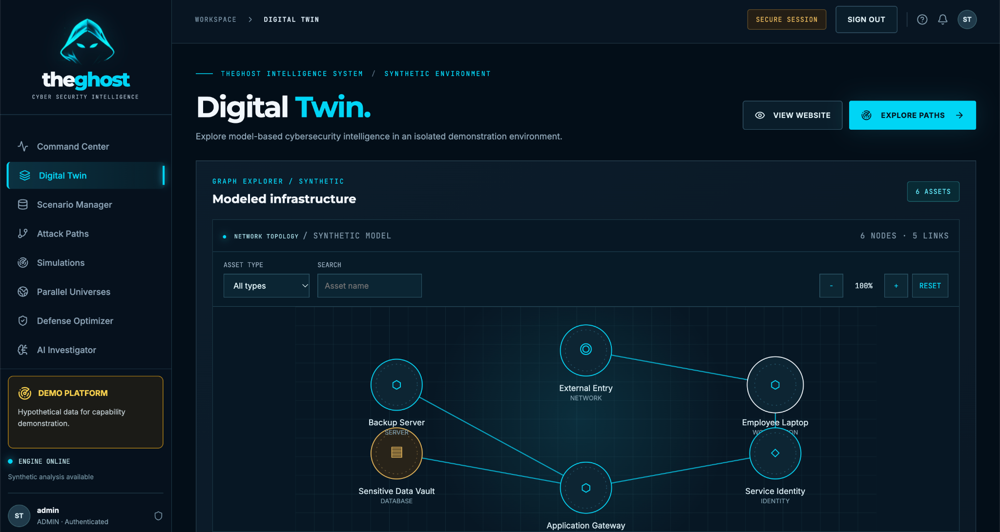
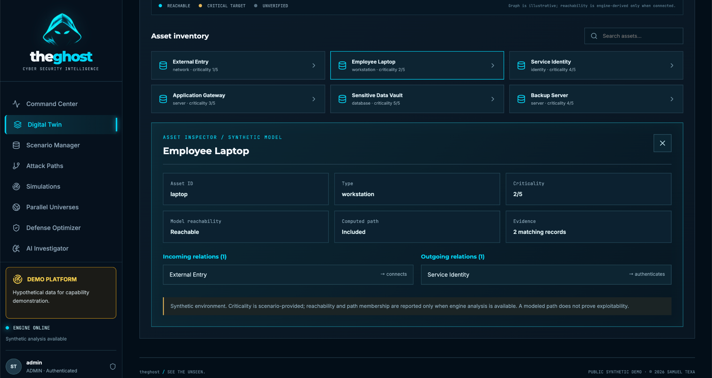
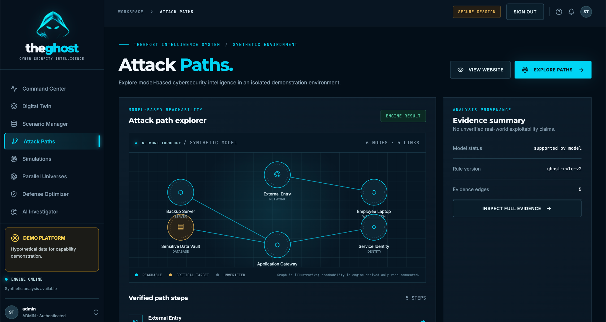
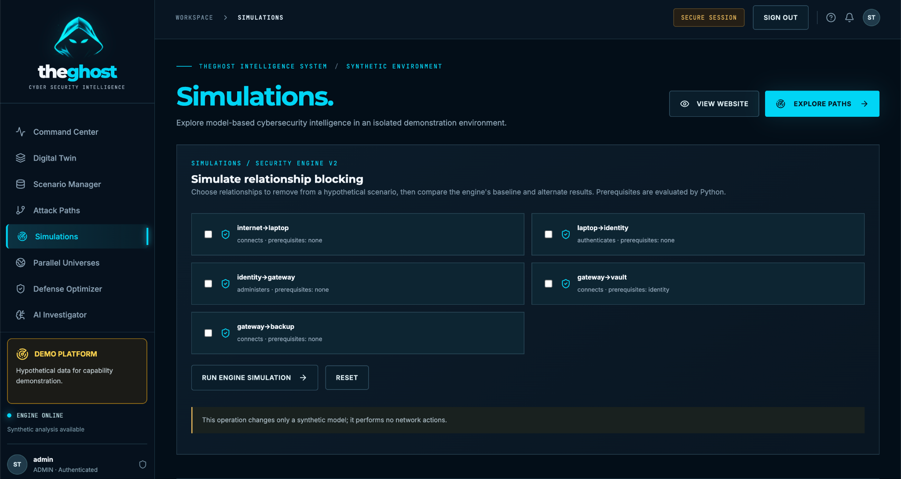
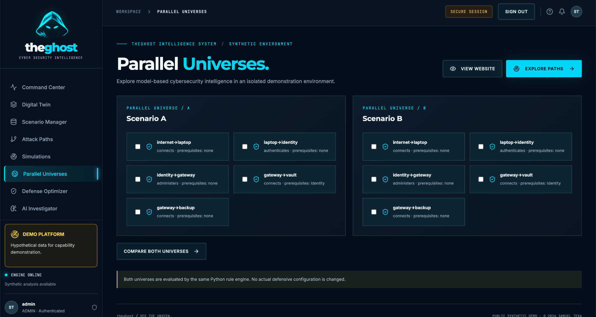
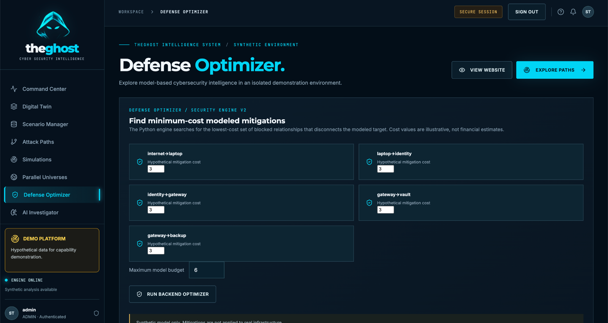
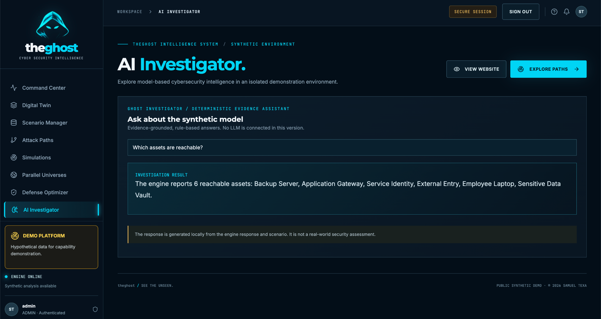
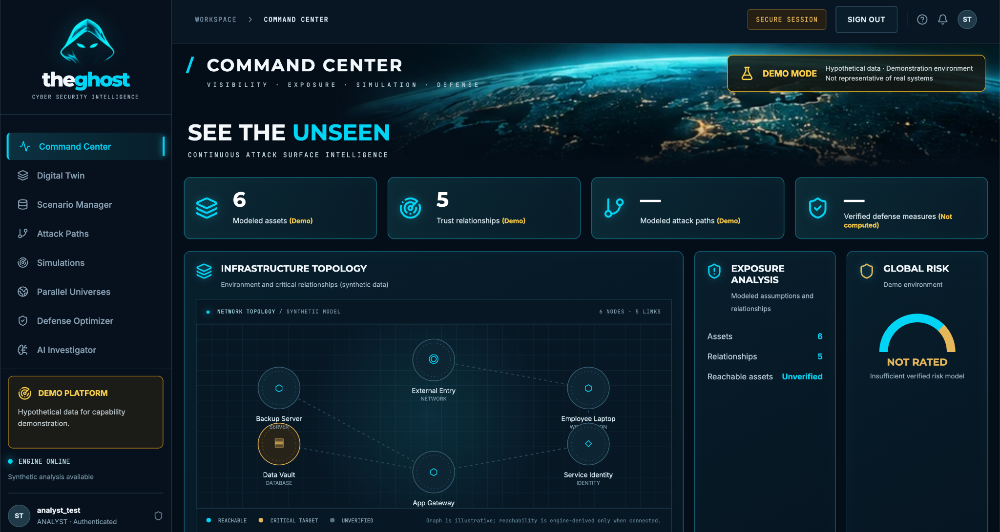

# theghost

**Advanced Cybersecurity Digital Twin & Attack Path Intelligence Platform**  
**SEE THE UNSEEN.**

Copyright © 2026 Samuel Texa · MIT License

## Engineering & Security Decisions

Read [Engineering & Security Decisions](docs/engineering/SECURITY_DECISIONS.md) for the rationale behind deterministic analysis, evidence provenance, scenario ownership and application security controls.

## Architecture

Read [System Architecture](docs/architecture/SYSTEM_ARCHITECTURE.md) for the components, trust boundaries and local execution model.

## Technical Evidence

Read [Technical Evidence & Verification](docs/security/TEST_EVIDENCE.md) and [Threat Model](docs/security/THREAT_MODEL.md).

## Scope

Synthetic demonstration only. Not a vulnerability scanner, exploitation framework, production security assessment or proof of real-world exploitability.

**Author:** Samuel Texa · **License:** MIT

---

## Screenshots

Real screenshots from the locally running theghost application.
All modeled infrastructure and analysis data are synthetic.

### Platform Overview



### Command Center



### Digital Twin & Asset Inspection





### Attack Path Analysis



### Simulations & Scenario Comparison





### Defense Optimization



### Deterministic Investigator



The investigator uses deterministic, evidence-grounded responses.
No LLM is connected in this release.

### Role-Based Interface



The administrator and analyst screenshots illustrate different
authenticated sessions. Authorization is enforced by the backend
and covered by automated security tests.

---

## Implemented capabilities

- Responsive React and TypeScript dashboard with a public synthetic demonstration.
- Synthetic enterprise asset and relationship modeling.
- Deterministic attack-path reachability analysis with explicit prerequisites and evidence.
- SHA-256 scenario fingerprinting for reproducibility.
- Scenario comparison and bounded mitigation search through the Python engine.
- Java Spring Boot API with session-based authentication.
- Role-based access control for ADMIN and ANALYST users.
- CSRF protection and login attempt rate limiting.
- Security event auditing.
- PostgreSQL-backed user and scenario operations.
- Ownership checks for scenario access and modification.
- Docker Compose orchestration for frontend, API, engine and PostgreSQL.
- Automated Java security tests and HTTP smoke checks.

## Scope and limitations

The platform currently focuses on synthetic cybersecurity modeling.
It is not a vulnerability scanner, penetration-testing framework,
or proof of exploitability in real infrastructure.

Authentication, authorization and scenario ownership controls have
automated test coverage, but this does not constitute an independent
production security assessment.

Advanced laboratory orchestration, local LLM integration, scalable
optimization and complete interactive simulation integration across
all dashboard views remain outside the verified release scope.

Do not expose the application publicly without an independent
security review and production deployment hardening.

## Run locally (Mac / Docker Desktop)

1. Extract the ZIP, open Terminal in the `theghost` folder.
2. Create a local password file:
   ```bash
   cp .env.example .env
   python3 -c 'import secrets,pathlib;pathlib.Path(".env").write_text("POSTGRES_PASSWORD="+secrets.token_hex(32)+"\n")'
   ```
3. Start Docker Desktop, then run:
   ```bash
   docker compose up --build -d
   docker compose ps
   ```
4. Open **http://localhost:4173**.
5. API: **http://localhost:8080/api/v1/health**; engine: **http://localhost:8001/health**.
6. Stop without deleting data: `docker compose down`.

Docker images and package dependencies must be downloaded on the first build. Use `docker compose logs --tail=100` to investigate startup errors.

## Run engine tests (Python)

```bash
cd engines/security-engine
python3 -m venv .venv
source .venv/bin/activate
pip install -r requirements.txt pytest
python -m pytest -q
```

## API routes

- `GET /health`
- `GET /demo/scenario`
- `GET /demo/analysis`
- `POST /analyze` (validated synthetic scenario)
- `POST /compare` (scenario and blocked relationship IDs)
- `POST /optimize` (bounded candidate mitigation search)

Python engine endpoints are bound to loopback in the Docker configuration. This is a synthetic modeling tool, not an exploit framework or vulnerability scanner.

## Architecture and security boundaries

`React -> Spring Boot demo gateway -> Python engine`; PostgreSQL is provisioned for the next development milestone. Demo content contains no private data. The engine accepts structured data only, does not execute user-supplied code, and does not scan external systems. API CORS is limited to local development origins; network publishing requires a new threat model, authentication, authorization, rate limits, persistence controls and independent security review.

## Project status

**Functional prototype / Phase 1+ engine proof of concept.** The full planned platform is not yet complete. See `docs/ROADMAP.md` and `docs/SECURITY.md`.

## Author

Samuel Texa

## License

MIT — see [LICENSE](LICENSE).
