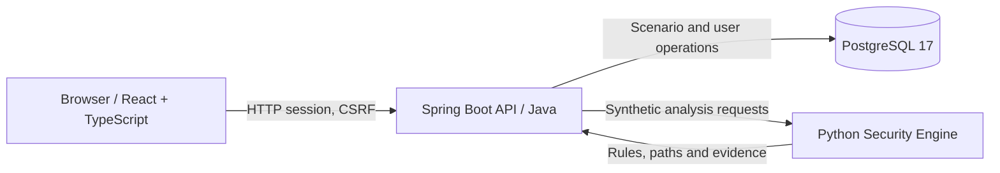

# System Architecture

## Component overview

The web client presents the synthetic demonstration and authenticated workspace. The Java API handles application-level security and orchestration. PostgreSQL persists users and scenario data. The Python engine evaluates modeled relationships and produces deterministic analysis results.

## Local execution

Docker Compose starts the frontend, API, engine and database. Development ports are bound to `127.0.0.1`. The public GitHub repository distributes source code; it does **not** mean the application is hosted publicly.

## Trust boundaries

1. **Browser → API:** treat all requests as untrusted; authorization must be checked server-side.
2. **API → database:** persistence and ownership constraints protect user and scenario records.
3. **API → engine:** accept structured synthetic scenarios; the engine is not a remote network scanner.
4. **Developer workstation → Docker services:** local-only exposure reduces network reachability but does not constitute production hardening.

## Current constraints

The displayed graph is illustrative. Reachability and path evidence are meaningful only when backed by engine results. No real-world vulnerability scanning, exploitation or independent security guarantee is provided.
